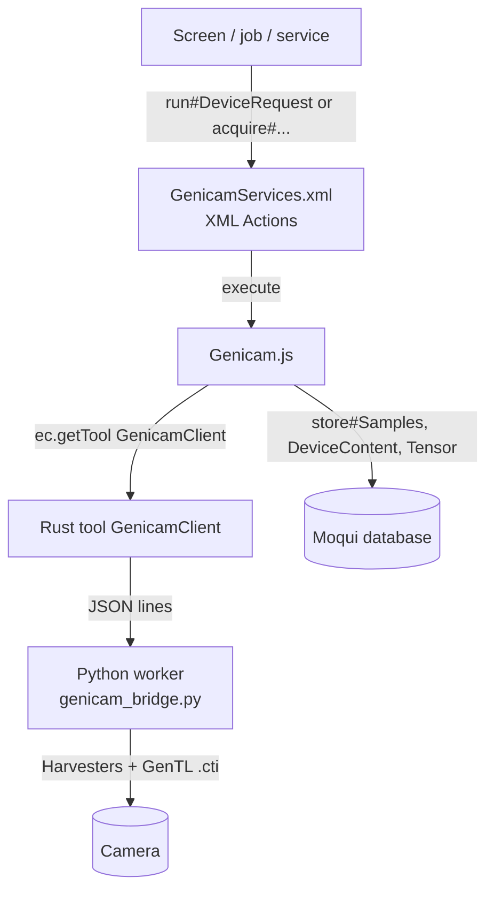

# moqui-genicam

`moqui-genicam` connects GenICam vision cameras (FLIR/Teledyne, Basler, IDS, Baumer and others with a GenTL
producer) to the device model of [moqui-device](https://github.com/moqui/moqui-device). It configures and reads
cameras, captures images, frame series, video files, multi-camera recordings and 3D (Time-of-Flight) frames, and
streams live MJPEG to a browser.

| Branch | Content |
|---|---|
| `master` | The Java/Groovy component for Moqui Java: Groovy classes, and the Python bridge in JEP |
| `mr-moqui` | This port to [MR-Moqui](https://github.com/moqui/mr-moqui): Rust and JavaScript in place of Groovy |

The port follows moqui-device and moqui-device-gateway ([SERVICE-PORT.md](SERVICE-PORT.md)):

- **Services.** The services keep their names and parameters, and stay XML Actions.
- **Groovy scripts.** The work of the services' Groovy scripts, and of the class `GenicamUtil`, is the JavaScript
  library `service/moqui/genicam/Genicam.js`.
- **Groovy classes.** The classes that talk to the camera are Rust tools:
  - `GenicamClient`, for one camera;
  - `GenicamMultiCameraRunner`, for a multi-camera recording.
- **Python.** The camera side stays Python (`script/genicam_bridge.py`, `script/multi_camera_capture.py`):
  Harvesters and the vendor's GenTL producer are what the camera SDK provides.

## Model

The cameras are moqui-device data, with no camera code in the model:

- **Camera model and camera.** The camera model is a `Device`. A connected camera is a `Device` with a
  `PhysicalDevice`, whose `serialNumber` is the camera's serial number.
- **Driver.** `DeviceConnection` uses the driver `DcdGenicam`:
  - `transportConfig` is the path of the `.cti` GenTL producer;
  - `options` can set `serial=...`, which takes precedence over the `PhysicalDevice` serial number.
- **Nodes.** The camera's GenICam nodes (`ExposureTime`, `Gain`, `TriggerMode`, ...) are `ParameterDef` and
  `Parameter` rows of moqui-math. A `DeviceRequest` reads or writes them, with the node name in
  `DeviceRequestItem.query`.
- **Status.** The camera's status follows `GenicamCameraStatusFlow` of moqui-device.

`data/GenicamData.xml` (seed) adds the device type `DtVisionCamera`, the driver `DcdGenicam`, the item type
`DritString` and the job `clean_GenICamTensors_daily`. `data/GenicamTestData.xml` (test) holds:

- the mock camera `FLIR_CAMERA_1`;
- two real FLIR cameras for manual tests;
- the requests `FLIR_ReadState`, `FLIR_TriggerShot`, `FLIR_StartStreaming`, `FLIR_StopStreaming` and
  `FLIR_GetFrame`.

## Services

All are in `moqui.genicam.GenicamServices`.

| Service | Use |
|---|---|
| `run#GenICamRequest` | The `runServiceName` of a GenICam `DeviceRequest`, called by `moqui.device.DeviceServices.run#DeviceRequest`. `DrtRead` reads the nodes of the request items; `DrtWrite` writes the values of their Parameters. The values the camera answers are stored with `DeviceAcquisitionServices.store#Samples`, as for every other driver: current Parameter values, and `ParameterLog` rows for a `DrpLogging` request |
| `acquire#SingleImage` | One frame as a jpg, png or bmp file, registered as a `DeviceContent` (`DCntImage`) |
| `acquire#VideoStream` | `numFrames` frames as image files, each a `DeviceContent` |
| `acquire#VideoFile` | An avi or mp4 file of `numFrames` frames at `fps` |
| `acquire#MultiVideoFile` | A video file on each camera of `deviceIdList` at the same time, each camera in a Python process of its own |
| `acquire#VisualServoFrame` | One frame for a visual servoing loop: the latest frame of the streaming thread, or a new capture, with its bytes and capture time; optionally saved as a `DeviceContent` |
| `stream#LiveMjpeg` | A `multipart/x-mixed-replace` response of `maxFrames` JPEG frames, one every `frameDelayMs`, each sent as it is written. Needs a web request and an authenticated user: the servlet `script/GenicamStreamServlet.js` (see Live MJPEG) |
| `acquire#GenICam3DFrame` | A GenDC 3D frame as a moqui-math `Tensor`, with one `TensorAxis` per dimension and the NPY file as `TensorContent` |
| `clean#GenICamTensors` | Deletes the 3D frames older than `daysToKeep`: NPY file, `TensorContent`, `TensorAxis` and `Tensor`, one transaction per tensor. The job `clean_GenICamTensors_daily` runs it at 02:00 |

A camera failure sets the `Device` to `DbsErrorStop`, as the Python bridge did in the Java version. The service then
returns the error.



## Rust tools and Python workers

- **Workers.** In the Java version the bridge ran in a JEP interpreter inside the JVM. Here the tool `GenicamClient`
  runs it as a Python worker process, one per camera (CTI path and serial number). The worker is started at the
  first call and kept, so the camera connection, the streaming thread and the latest frame live between calls, as
  they did in the interpreter.
- **Concurrency.** Calls to one camera wait for each other; calls to different cameras do not.
- **Timeouts.** `genicam.process.timeout.ms` (120 s by default) limits one answer of the worker. A call that times
  out stops the worker, and its command is not sent again, since a write or a trigger may already have reached the
  camera. The next call starts a new worker.
- **Data exchange.** Requests and answers are JSON lines. Byte buffers travel as base64 and are bytes again in Moqui.
- **Database writes.** The worker has no execution context, so it does not write to the database. The `DeviceContent`
  rows, the Tensor rows and the error status are written by `Genicam.js`.
- **Python interpreter.** The tool uses `runtime/python_venv` as the Java version did; otherwise the `PYTHON`
  environment variable, or `python3`/`python` on the `PATH`.

## Installation

1. **Clone the components.** Put this repository at `runtime/component/moqui-genicam` of MR-Moqui, with moqui-device
   and moqui-math on their `mr-moqui` branches. The crate uses the framework's `moqui-core` and `moqui-lib` through
   relative paths.
2. **Build:**
   ```sh
   ./moq build
   ```
3. **Install the Python packages** of `requirements.txt` (NumPy, OpenCV, Harvesters) in `runtime/python_venv`:
   ```sh
   python3 -m venv runtime/python_venv
   runtime/python_venv/bin/pip install -r runtime/component/moqui-genicam/requirements.txt
   ```
4. **Install the camera vendor's GenTL producer.** For FLIR/Teledyne cameras this is the Spinnaker SDK, for
   example:
   - `/opt/spinnaker/lib/spinnaker-gentl/Spinnaker_GenTL.cti` on Linux;
   - `C:\Program Files\Teledyne\Spinnaker\cti64\vs2015\Spinnaker_GenTL_v140.cti` on Windows.

   Put its path in `DeviceConnection.transportConfig`.
5. **Load the data:**
   ```sh
   ./moq load types=seed,seed-initial
   ```

### Simulation

Without Harvesters or without the `.cti` file, the bridge simulates the camera. It does the same for the serial
number `FLIR_CAMERA_1` and for any serial containing `mock`. This is the behaviour of the Python bridge, which
belongs to the camera side and is unchanged. Check the connection on a real installation: a missing driver is not
reported as an error.

## Configuration

These are the default properties of `MoquiConf.xml`. A service parameter of the same meaning takes precedence.

| Property | Default | Use |
|---|---|---|
| `genicam.images.path`, `.frames.path`, `.videos.path`, `.servo.path`, `.tensors.path` | `runtime/genicam/...` | Output directories (relative to the runtime directory) |
| `genicam.image.format` | `jpg` | `jpg`, `png` or `bmp` |
| `genicam.video.container`, `genicam.video.codec` | `avi`, `MJPG` | `avi`/`mp4`; `MJPG`, `XVID` or `mp4v` |
| `genicam.frames.default.numFrames`, `genicam.videos.default.numFrames`, `genicam.videos.default.fps` | `10`, `60`, `15.0` | Frame counts and rate |
| `genicam.<images,frames,videos,servo>.resize.width/height` | empty | Resize of the frames |
| `genicam.connection.retry.count`, `.retry.backoff.ms`, `.fetch.timeout.ms` | `3`, `1000`, `1000` | Connection retries with exponential backoff, and the frame fetch timeout |
| `genicam.stream.max.frames`, `genicam.stream.frame.delay.ms` | `100`, `66` | Live MJPEG |
| `genicam.stream.stop.timeout.ms`, `genicam.stream.mock.frame.delay.ms` | `3000`, `100` | Streaming thread |
| `genicam.servo.default.useCachedFrame`, `.saveSnapshot`, `genicam.servo.buffer.source`, `genicam.servo.max.frame.age.ms` | `true`, `false`, `latest`, `250` | Visual servoing |
| `genicam.process.timeout.ms` | `120000` | The longest wait for an answer of a camera's worker |
| `genicam.multi.process.timeout.ms` | `120000` | The longest multi-camera recording |

## Live MJPEG

`stream#LiveMjpeg` writes its response frame by frame. On MR-Moqui a response goes out while it is written only from a
render or from a servlet script; a screen transition sends it whole at the end. The component ships the servlet
`script/GenicamStreamServlet.js`, and the application declares it in its conf, in the `webroot` webapp.

When a webapp declares a servlet it no longer gets the default ones, so the conf declares them too:

```xml
<webapp-list>
    <webapp name="webroot">
        <servlet name="MoquiServlet" class="org.moqui.impl.webapp.MoquiServlet"><url-pattern>/*</url-pattern></servlet>
        <servlet name="MoquiFopServlet" class="org.moqui.impl.webapp.MoquiFopServlet"><url-pattern>/fop/*</url-pattern></servlet>
        <servlet name="GenicamStream" location="component://moqui-genicam/script/GenicamStreamServlet.js">
            <url-pattern>/genicam/stream</url-pattern>
        </servlet>
    </webapp>
</webapp-list>
```

The users who watch need permission on the service `moqui.genicam.GenicamServices.stream#LiveMjpeg`, for example an
`ArtifactGroupMember` (`AT_SERVICE`) of an `ArtifactGroup` granted to their user group. A browser of a signed-in user
then shows the camera with:

```html

```

| Parameter | Use |
|---|---|
| `deviceId` | The camera (required) |
| `connectionName` | One of the camera's connections, else its own |
| `maxFrames` | The frames to send (`genicam.stream.max.frames`, 100) |
| `frameDelayMs` | The pause between frames (`genicam.stream.frame.delay.ms`, 66) |

- **Source of the frames.** The frames are the latest frames of the camera's streaming thread. Start it first with a
  `DrtWrite` of `AcquisitionStart`, as the request `FLIR_StartStreaming` does.
- **Disconnected clients.** A script cannot see that the client went away, so a stream always ends after `maxFrames`
  frames, as the Java version did. Set `maxFrames` to the length of the view and reload the image to go on.
- **Request deadline.** A script on a request thread stops at the request deadline (`webapp_request_timeout`, 300 s):
  keep `maxFrames` × `frameDelayMs` below it.
- **Threads and workers.** Each viewer holds a request thread while the stream lasts, and the viewers of one camera
  share its worker.

## Multi-camera recording

`acquire#MultiVideoFile` finds each `Device` and its `DeviceConnection`. The tool `GenicamMultiCameraRunner` then runs
`script/multi_camera_capture.py`, which starts a Python process per camera, so the SDK state of each camera is
separate.

```text
deviceIdList=["CAMERA_A","CAMERA_B"]
connectionNameList=["ConnA","ConnB"]    # optional, by index
numFrames=120
fps=10.0
```

It returns:

- `captureResults`, one per camera;
- `successfulCount`;
- `failedCount`.

## Visual servoing

`acquire#VisualServoFrame` returns `capturedAt` in Unix seconds, so a loop can drop frames that are too old:

```text
1. Start the camera's streaming thread (a DrtWrite of AcquisitionStart, as FLIR_StartStreaming).
2. Take the latest frame: acquire#VisualServoFrame(useCachedFrame=true).
3. Drop it when it is older than the latency budget (genicam.servo.max.frame.age.ms).
4. Run the vision model on it, send the correction to the robot or PLC.
5. Repeat at a fixed cycle time.
```

The latest frame wins, with no queue. When the cached frame is stale, take a new one with `useCachedFrame=false`.
Obstacle detection and camera-to-robot calibration are separate stages of the application. The
[ONNX trajectory example](https://github.com/moqui/moqui-device/tree/mr-moqui/examples/onnx-obstacle) of moqui-device
shows the planner side.

## 3D and Time-of-Flight frames

The bridge reads GenDC multi-part payloads (payload types 6 and 7):

1. It takes the spatial component (`Coord3D_ABC32f` or `Coord3D_C32f`).
2. It turns the component into a float32 NumPy array of shape `[height, width, 3]`.
3. It serializes the array as an NPY file.

`acquire#GenICam3DFrame` stores the frame as:

- a `Tensor`: `TtDense`, `TpImageRep`, rank 3, with the shape;
- one `TensorAxis` per dimension: `TapHeight`/Y, `TapWidth`/X, `TapChannel`/C;
- a `TensorContent` (`TCntNpy`) with the file location.

The file and the rows are not one transaction. `clean#GenICamTensors` only deletes tensors named
`GenICam 3D Frame - Camera ...` whose file is under `genicam.tensors.path`.

## Deployment notes

- **Container layout.** Run one camera-facing Moqui instance per camera, or per small group of cameras: GenTL
  producers do not always share a process well.
- **Mounts.** Mount the vendor SDK (for example `/opt/spinnaker`) read-only, and the `runtime/genicam` directories on
  persistent volumes.
- **GigE cameras.** Keep one network interface and MTU profile per camera group.
- **Video.** AVI/MJPG is the most portable video format.

## Tests

See [test/README.md](test/README.md).

```sh
./moq test moqui-genicam
```

The tests use the mock camera: no camera, SDK or Harvesters is needed, but NumPy and OpenCV are.

## Layout

| Path | Content |
|---|---|
| `service/moqui/genicam/GenicamServices.xml` | The services (XML Actions) |
| `service/moqui/genicam/Genicam.js` | Their logic: the Groovy scripts and `GenicamUtil` of the Java version |
| `src/client.rs` | Tool `GenicamClient` (Groovy `GenicamClient`) |
| `src/multi_camera.rs` | Tool `GenicamMultiCameraRunner` (Groovy `GenicamMultiCameraRunner`) |
| `src/worker.rs` | The Python worker processes, in place of the JEP interpreter |
| `script/genicam_bridge.py` | The camera: Harvesters, GenDC decoding, image and video encoding, streaming thread, mock camera |
| `script/multi_camera_capture.py` | The multi-camera recording processes |
| `script/GenicamStreamServlet.js` | The live MJPEG servlet, declared by the application's conf |
| `data/` | Seed data and test data |
| `test/` | The regression tests |
| `MoquiConf.xml` | The default properties and the tool factories |
| `requirements.txt` | The Python packages |
