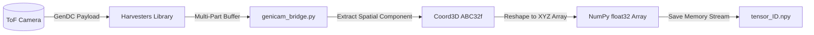
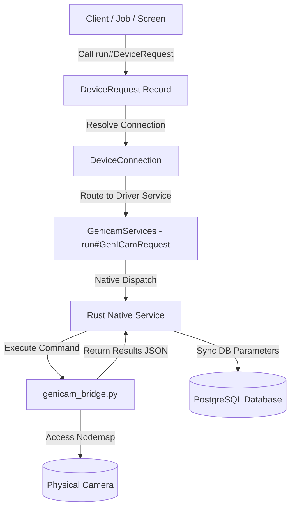

# moqui-genicam

`moqui-genicam` is a **model-first** and **data-driven** integration component for the Modern Rust Moqui Framework (`mr-moqui`). It provides configuration, control, and data acquisition capabilities for multi-brand vision cameras (e.g., FLIR, Basler, IDS, Baumer) by bridging Moqui's digital twin entity model (`moqui-device`) with the industry-standard **GenICam** framework via native Rust services, QuickJS tool integration, and the Python **Harvesters** library.

In `mr-moqui`, `moqui-genicam` replaces legacy Java Embedded Python (JEP) with a modern native Rust driver and CLI IPC architecture. Python code runs in camera-specific worker subprocesses using the camera SDKs while Moqui handles entities, transactions, and services natively in Rust and JavaScript.

---

## 🌟 Why `moqui-genicam` is Unique

Unlike typical IP camera streams (e.g. RTSP/ONVIF) or standard wrapper libraries that treat vision cameras as simple video feeds, `moqui-genicam` is designed from the ground up for **industrial automation** and **advanced machine vision**:

1. **Model-First Digital Twin**: The camera's settings, capabilities, and registers are not hardcoded. They are declared in Moqui's database using the `moqui-device` and `moqui-math` schemas (see the component `data` and `entity` folders). Changes to exposure, triggers, or frame rates require zero code modifications.
2. **Raw Buffer Processing**: Raw image buffers and Time-of-Flight (ToF) coordinate maps are processed directly in memory. Spatial buffers are decoded into NumPy arrays and saved as `.npy` files. Rust/Python IPC currently uses JSON with base64 buffers and therefore copies data; it is not a zero-copy transport.
3. **Rust & QuickJS Native Architecture**: Combines the performance and memory safety of `mr-moqui` (Rust core and embedded Postgres/SQL) with the scientific Python stack (NumPy, OpenCV, Harvesters) through a fast, robust native IPC bridge.
4. **Declarative XML Services**: Operations are organized via standard Moqui XML definitions with native Rust service bindings (`type="rust"`). Database transactions, file cleanups, and camera status changes are executed declaratively with standard validation and logging.

---

## 🛠️ Core Features & 3D/ToF Integration

### 1. 3D & Time-of-Flight (ToF) Spatial Imaging
The driver incorporates complete support for **GenDC (GenICam Data Container) Multi-Part payloads** (Payload Types 6 and 7):
* **Component Extraction**: Automatically scans multi-part buffers to isolate spatial components (containing `Coord3D_ABC32f` or `Coord3D_C32f` formats).
* **Buffer-to-Tensor Conversion**: Raw binary buffers representing spatial 3D points are converted directly into NumPy float32 arrays (shape: `[Height, Width, 3]` representing $X, Y, Z$ spatial coordinates).
* **Binary Serialization**: Decoded arrays are serialized into standard `.npy` binary files using in-memory streams, bypassing standard image conversions that discard spatial precision.



### 2. Transactional Database Persistence (`moqui.math.Tensor`)
When a 3D frame is captured, `moqui-genicam` integrates the frame directly into Moqui's database using the `moqui-math` Tensor schemas:
* **Tensor Entity**: Saves a new `moqui.math.Tensor` record storing type (`TtDense`), purpose (`TpImageRep`), rank (3), and dimensions (e.g. `[480, 640, 3]`).
* **Axis Definitions**: Dynamically creates `moqui.math.TensorAxis` records defining dimensions and strides:
  * Axis 0: Height (`TapHeight` / `Y`)
  * Axis 1: Width (`TapWidth` / `X`)
  * Axis 2: Channels (`TapChannel` / `C` - coordinates $A, B, C$)
* **Content Record**: Creates a `moqui.math.TensorContent` record pointing to the `.npy` file location on disk.
* **Persistence boundary**: Rust persists Tensor/Axis/Content and DeviceContent records in Moqui; the Python worker has no ExecutionContext. Filesystem writes are not transactional with the database. Operators must reconcile files after a failed persistence operation.

### 3. Resilient Fail-Safe & Status Transitions
To protect industrial workflows, camera connection and acquisition errors trigger automatic state changes:
* **Error Interception**: If a camera times out, disconnects, or fails to initialize, the Rust client intercepts the failure.
* **State Transition**: The `moqui.device.Device` record status is automatically transitioned to `DbsErrorStop` through the Moqui entity-auto update service, subject to the configured status flow and permissions.
* **Backoff Retry**: Persistent connection attempts are retried up to 3 times with exponential backoff (1s, 2s, 4s) before declaring a hardware failure.

### 4. Scheduled Tensor Maintenance (Daily ServiceJob)
High-frame-rate 3D cameras generate massive amounts of data. `moqui-genicam` includes a background cleanup engine to prevent disk space exhaustion:
* **Daily Cron Job**: A scheduled job named `clean_GenICamTensors_daily` runs every day at 02:00 AM (`0 0 2 * * ?`).
* **Declarative Service**: Invokes the `clean#GenICamTensors` native Rust service.
* **Scoped retention**: Removes expired NPY files only for GenICam-named tensors under the configured `genicam.tensors.path`, checking canonical paths before deletion. It removes the matching TensorContent and keeps Tensor/Axis metadata because other models may reference them. Foreign tensors and custom output roots are skipped. `daysToKeep` must be positive. Filesystem deletion and database changes are not one atomic transaction.

---

## 📋 Architecture & Services

The component implements the standard `moqui.device.DeviceServices.run#DeviceRequest` interface.



### Services Summary

| Service Name | Purpose | Implementation |
| :--- | :--- | :--- |
| `run#GenICamRequest` | Processes read/write commands (e.g. exposure, triggers) | `type="rust"` |
| `acquire#SingleImage` | Captures one frame and saves it to disk as `.jpg`, `.png`, or `.bmp` | `type="rust"` |
| `acquire#VideoStream` | Captures a finite number of 2D/JPEG frames | `type="rust"` |
| `acquire#VideoFile` | Records a short `.avi` or `.mp4` video file from the camera | `type="rust"` |
| `acquire#MultiVideoFile` | Coordinates multi-camera video captures using separate worker processes | `type="rust"` |
| `stream#LiveMjpeg` | Progressive JPEG multipart response in an authenticated HTTP screen; finite or continuous | `type="rust"` |
| `acquire#GenICam3DFrame` | Decodes a GenDC 3D frame and persists it as a DB Tensor | `type="rust"` |
| `clean#GenICamTensors` | Deletes old 3D tensor files and database records | `type="rust"` |

---

## 🗂️ Component Directory Layout

*   `component.xml`: Declares dependencies on `moqui-math` and `moqui-device`.
*   `Cargo.toml`: Declares the Rust crate and dependencies on `moqui-core` and `moqui-lib`.
*   `MoquiConf.xml`: Defines default output paths, image format, video container/codec, resize settings, and registers `GenicamClientFactory` tool.
*   `src/lib.rs`: Rust component registration (`submit_component!`) and service catalogue.
*   `src/client.rs`: `GenicamClient` struct, tool factory, and JavaScript Tool implementation.
*   `src/services.rs`: Native Rust service endpoints.
*   `src/worker.rs`: Persistent per-camera JSON-lines workers, deadlines and shutdown.
*   `src/util.rs`: Path resolutions, parameter synchronization, and tensor persistence.
*   `src/multi_runner.rs`: Parallel multi-camera runner.
*   `data/GenicamData.xml`: Defines the scheduled cleanup `ServiceJob`.
*   `data/GenicamTestData.xml`: Contains test camera definitions, connection configurations, and test requests.
*   `script/genicam_bridge.py`: Core Python bridge code (connecting Harvesters, decoding GenDC, converting pixel formats, and handling hardware operations).
*   `script/multi_camera_capture.py`: Multi-camera parallel acquisition script.
*   `service/moqui/genicam/GenicamServices.xml`: Declares Moqui services with native Rust bindings.
*   `requirements.txt`: Declares required Python packages (`harvesters`, `numpy`, `opencv-python`).

---

## 🚀 Building & Testing in `mr-moqui`

Install the `mr-moqui` branches of moqui-math, moqui-device and this component
under MR-Moqui master's `runtime/component`, then run commands from the framework
root. Mantle is not required for normal use or for this component's own camera tests.

### 1. Build the Application
```bash
./moq build --debug
```

### 2. Check for Groovy Compatibility
Ensure zero Groovy idioms remain in XML definitions:
```bash
./target/debug/moqui lint --groovy runtime/component/moqui-genicam
```

### 3. Load Data
```bash
./target/debug/moqui load types=seed,seed-initial components=framework,moqui-math,moqui-device,moqui-genicam
```

### 4. Hardware Configuration
To configure real hardware, update the `DeviceConnection` records in your database to point to your physical GenTL driver (examples):

- Windows example: `C:\Program Files\Teledyne\Spinnaker\cti64\vs2015\Spinnaker_GenTL_v140.cti`
- Linux example: `/opt/vendor/cti/Spinnaker_GenTL_v140.cti`

Then set your camera's real serial number in the connection options.

For direct acquisition tests against a connected camera:
```text
moqui.genicam.GenicamServices.acquire#SingleImage
moqui.genicam.GenicamServices.acquire#VideoFile
moqui.genicam.GenicamServices.acquire#MultiVideoFile
moqui.genicam.GenicamServices.acquire#VideoStream
```

Typical parameters:
```text
deviceId=FLIR_CAMERA_1
connectionName=FlirCameraConnection
outputDir=runtime/genicam/images
numFrames=120
fps=15.0
```

Default media configuration is resolved from `MoquiConf.xml`, with optional per-service overrides:
```text
genicam.images.path
genicam.frames.path
genicam.videos.path
genicam.servo.path
genicam.tensors.path
genicam.image.format        # jpg, png, bmp
genicam.video.container     # avi, mp4
genicam.video.codec         # MJPG, XVID, mp4v
genicam.frames.default.numFrames
genicam.videos.default.numFrames
genicam.videos.default.fps
genicam.connection.retry.count
genicam.connection.retry.backoff.ms
genicam.connection.fetch.timeout.ms
genicam.stream.max.frames
genicam.stream.frame.delay.ms
genicam.stream.stop.timeout.ms
genicam.stream.mock.frame.delay.ms
genicam.servo.default.useCachedFrame
genicam.servo.default.saveSnapshot
genicam.servo.buffer.source
genicam.servo.max.frame.age.ms
genicam.multi.process.timeout.ms
genicam.process.timeout.ms
```

---

## Multi-Camera Coordinator

`acquire#MultiVideoFile` coordinates parallel multi-camera recording. The service resolves each `Device` and `DeviceConnection` in Moqui, then launches worker processes per camera so that camera SDK state is isolated at the operating-system process level.

Typical usage:
```text
deviceIdList=["CAMERA_A","CAMERA_B"]
connectionNameList=["ConnA","ConnB"]    # optional
numFrames=120
fps=10.0
outputDir=runtime/genicam/videos
videoContainer=avi
videoCodec=MJPG
```

---

## Visual Servoing Pattern

`acquire#VisualServoFrame` returns `capturedAt` as a string of Unix seconds
(including fractional seconds), preserved from the Python bridge's `time.time()`.
Consumers must parse it before applying their frame-age budget. Adapters may also
return a timestamp string; preserve the timestamp's timezone when converting it.
The service acquires frames; obstacle detection and camera-to-robot calibration
are separate application stages.

An optional [Rust ONNX trajectory example](https://github.com/moqui/moqui-device/tree/mr-moqui/examples/onnx-obstacle)
in moqui-device replays a simulated calibrated obstacle after a frame, runs a
real ONNX neural network, and checks the changed path. It runs independently of
camera hardware and does not dispatch motion to a controller.

Recommended loop:
```text
1. Start streaming/caching for the camera.
2. Pull the latest cached frame with acquire#VisualServoFrame(useCachedFrame=true).
3. Reject frames older than the configured latency budget.
4. Run vision inference on the cached frame only.
5. Send robot/PLC correction.
6. Repeat at a fixed cycle time.
```

Practical buffering pattern:
```text
- buffer strategy: latest-wins
- producer: background acquisition thread updates the latest frame cache
- consumer: servo loop reads one frame snapshot without queue buildup
- latency control: cap camera fetch timeout and consumer cycle time
- fallback: if cache is stale, reacquire with useCachedFrame=false
```


## Worker lifecycle, simulation and regression tests

Rust keeps one Python JSON-lines worker per CTI/serial pair within the Moqui tool
factory. Consecutive calls share the camera connection, latest-frame cache and
streaming thread. `GenicamClient.close()` closes that camera's worker; factory
shutdown closes all workers. Calls to different cameras use separate worker locks.
The worker returns binary fields as `{"__base64__":"..."}`; native services decode
them to Moqui byte buffers. Resizing/re-encoding preserves the capture timestamp.

`genicam.process.timeout.ms` bounds a request (default 120000 ms). On an IPC error
or timeout the worker is terminated and removed; writes/triggers are never
automatically replayed after an uncertain outcome. A later call can create a new
worker. Multi-camera captures have a separate coordinator and per-worker timeout.

Simulation must be explicit: use CTI `mock`, the test camera `FLIR_CAMERA_1`, or
a serial containing `mock`. Missing Harvesters or a missing real CTI driver
produces an error; it no longer silently produces simulated observations.
`DeviceConnection.options` supplies `serial=...`; physical serial numbers belong
to `PhysicalDevice`, not `Device`. A named connection must belong to the requested
camera.

The [component regression tests](test/README.md) exercise real Rust services
against the Python mock camera, including image buffers and DeviceContent, 3D
Tensor/NPY persistence, connection ownership and retention isolation. See [the validation record](test/VALIDATION.md) for executed checks.
The Python acquisition path was previously tested with two physical FLIR cameras
(as reported by the maintainer). The new Rust bridge/HTTP checks use explicit
mock acquisition; measured Rust servo-loop latency and sustained hardware MJPEG
throughput are outside those regression tests.

## Live MJPEG over HTTP

`moqui.genicam.GenicamServices.stream#LiveMjpeg` now streams JPEG parts
progressively through MR-Moqui's native `web::ResponseStream`. Update/build
MR-Moqui with this API before building this component. The extension is published
in [moqui-industrial/mr-moqui, generic-http-streaming](https://github.com/moqui-industrial/mr-moqui/tree/generic-http-streaming).
Build the framework from that branch until the generic API is integrated upstream.
The service requires an active HTTP request; a headless call returns an error.

Mount `component://moqui-genicam/screen/GenicamStream.xml` as a subscreen in your
application. For example, inside its existing `<subscreens>` declaration:

```xml
<subscreens-item name="GenicamStream"
    location="component://moqui-genicam/screen/GenicamStream.xml"/>
```

The supplied screen requires authentication. Grant the application's users the
appropriate screen/service artifact permissions, and use their authenticated
session when requesting the stream. No anonymous camera endpoint is installed.
With a mount at `/GenicamStream`, a browser image can use:

```html

```

`connectionName` selects an optional modeled connection owned by the camera.
`maxFrames` defaults to 100; `0` streams until disconnect. `frameDelayMs`
defaults to 66 and accepts 1..60000 ms. The response uses
`multipart/x-mixed-replace; boundary=moqui-frame`, with per-frame content lengths,
a closing boundary for finite streams and no overall body buffering. Disable
proxy buffering for this route (`X-Accel-Buffering: no` is sent).

The first JPEG is acquired before the response starts, so initial camera errors
return through normal service error handling. Later capture errors terminate
the body. Frames use the persistent worker for the CTI/serial pair; different
viewers of the same camera share that worker. Capture is requested as the HTTP
body is consumed, with no unbounded frame queue. Disconnect signals cancellation
to the producer. Delays are interruptible; camera lock
waits and IPC reads check cancellation at short intervals and have a total
5-second deadline. An interrupted in-flight capture retires its worker without
replaying the command; subsequent calls can reopen that camera. Cancellation
while waiting for a busy camera leaves the active caller's worker alone.
Factory shutdown closes workers and rejects subsequent acquisitions.

MJPEG uses a dedicated blocking-stream thread. The framework defaults to at
most 16 blocking streams per process (`webapp_stream_blocking_max`); excess
streams receive HTTP 503. Async streams do not consume those threads.
A slow camera sets the achievable frame rate.

The [HTTP test](test/mjpeg_http.py) checks progressive delivery, finite closure,
continuous-stream disconnect and subsequent capture, using the explicit mock
camera. See [test instructions](test/README.md).

## Native ONNX trajectory integration

`moqui.device.TrajectoryPlannerServices.run#RobotArmTrajectoryPlanner` is an
invocable Moqui service. With the optional `moqui-device/onnx` feature it loads
the registered ONNX model through a reusable `Onnx` ToolFactory session and runs
inference inside MR-Moqui through `ort` and ONNX Runtime; an HTTP provider is not required. The [isolated example](https://github.com/moqui/moqui-device/tree/mr-moqui/examples/onnx-obstacle)
includes the native call and an optional remote-provider mode.

GenICam supplies frames and timestamps. A detector and camera-to-robot calibration
must supply an obstacle observation before requesting a new trajectory from the
current TCP pose. The example simulates that stage and validates a narrow point
path; it is not a commissioned robot collision avoidance system.
